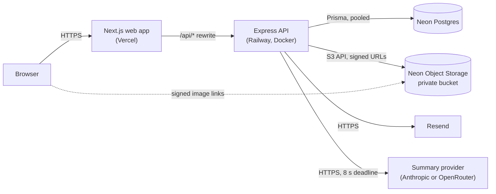
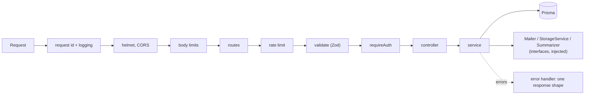

# Travel Photo Journal

A private journal for travel photos. Register, verify your email, sign in (optionally with two-factor authentication), and keep your own collection of photos with a name, a location, a description and an automatically generated summary. Nobody else can see or change what you store.

| Part | Link                                         |
| ---- | -------------------------------------------- |
| Web  | _Live URL: added at release_                 |
| API  | _Live URL: added at release_ (`GET /health`) |
| Docs | [`docs/`](docs/README.md)                    |

## Features

- **Accounts:** registration with email verification (single-use, 24-hour links), sign-in with a short-lived access token and a rotating refresh token, optional TOTP two-factor authentication with a QR code.
- **Photos:** create, list (paginated, newest first), view, edit (optionally replacing the image) and delete. Images are validated by their actual content, stored privately and shown through short-lived signed links.
- **AI description:** in the add-photo form, "Write with AI" looks at the chosen picture and drafts the description, which you can edit before saving.
- **Summaries:** a short summary of each description is generated on save with the cheapest Claude model (Haiku, a fraction of a cent per photo), or via OpenRouter with model fallback; if it is unavailable, the photo still saves.
- **Privacy by construction:** every photo query is scoped to its owner, and another user's photo behaves exactly like one that does not exist.

## Tech stack, and why

| Area       | Choice                                                                    | Why                                                                                                                                                                                                                |
| ---------- | ------------------------------------------------------------------------- | ------------------------------------------------------------------------------------------------------------------------------------------------------------------------------------------------------------------ |
| API        | Node.js 22, Express 5, TypeScript (strict)                                | Small, explicit and easy to test: an app factory with injected collaborators instead of a framework container ([ADR-0001](docs/adr/0001-express-over-nestjs.md)).                                                  |
| Database   | Neon Postgres, accessed only through Prisma                               | See below.                                                                                                                                                                                                         |
| Validation | Zod on every input                                                        | One definition of what each endpoint accepts; unknown fields are dropped (which is also how a client-supplied summary is ignored).                                                                                 |
| Passwords  | argon2id                                                                  | Memory-hard, recommended by OWASP ([ADR-0003](docs/adr/0003-argon2id-for-password-hashing.md)).                                                                                                                    |
| Sessions   | 15-minute JWT (HS256) plus a rotating refresh token in an httpOnly cookie | Limits what a stolen access token is worth while keeping long sessions revocable ([ADR-0004](docs/adr/0004-refresh-token-rotation-in-httponly-cookie.md), [ADR-0009](docs/adr/0009-refresh-session-mechanics.md)). |
| Images     | Neon Object Storage (private, S3-compatible) behind a storage interface   | No public URLs, cheap egress, and a local-disk driver for development and tests ([ADR-0005](docs/adr/0005-r2-behind-a-storage-interface.md)).                                                                      |
| Email      | Resend HTTPS API in production, SMTP (Mailpit) locally                    | A real relay with a free tier, and a mail catcher so nothing external is needed in development.                                                                                                                    |
| Web        | Next.js (App Router), Tailwind CSS, Framer Motion                         | Simple pages, utility-class styling, light motion that respects reduced-motion settings.                                                                                                                           |
| Web data   | Redux Toolkit with RTK Query; react-hook-form and zod                     | Caching and one place for auth, errors and silent refresh ([ADR-0011](docs/adr/0011-web-client-state-and-session.md)).                                                                                             |
| Tests      | Vitest, supertest, a real Postgres                                        | Integration tests exercise the real routes and database; external services are replaced through their interfaces.                                                                                                  |
| Delivery   | Docker, Docker Compose, GitHub Actions                                    | One command to run the whole stack; CI checks format, lint, types, tests, build, images and dependencies.                                                                                                          |

### Why Neon Postgres with Prisma

The data is relational and ownership-driven: photos belong to users, tokens belong to users and chain to one another, and a verification token must be usable exactly once. That wants foreign keys, unique constraints, cascading deletes and transactions, which a document store would leave to application code. Postgres provides them; Neon provides it serverless, with a free tier and branching. Prisma gives typed queries and migrations and keeps raw SQL out of the codebase.

Two connection strings are used: `DATABASE_URL` is the **pooled** endpoint for the running API, and `DIRECT_URL` is the **direct** endpoint used only for migrations, because pooled connections do not support everything migrations need ([ADR-0002](docs/adr/0002-neon-postgres-with-prisma.md)).

## Architecture



The browser only ever talks to the web origin, so the refresh cookie is same-origin and no CORS is needed. Images are fetched directly from storage through links that expire after 15 minutes.

Inside the API, a request passes through a fixed pipeline, then a feature module:



```
backend/    Express API: src/config, lib, middleware, modules/{auth,photos}, prisma/
frontend/   Next.js app: app/, components/, store/ (RTK Query), lib/
docs/       backend/, frontend/, devops/, plus PRD, glossary, architecture and ADRs
.github/    CI workflow
.husky/     git hooks (pre-commit, commit-msg)
```

Details: [architecture](docs/architecture.md), [database](docs/backend/database.md).

## Getting started

Requirements: Node.js 22, npm, Docker.

**Everything in Docker** (database, migrations, mail catcher, API and web app):

```bash
cp backend/.env.example backend/.env   # fill in JWT_SECRET and TOTP_ENC_KEY (commands are in the file)
docker compose up --build
```

Open <http://localhost:3000>. Emails sent by the app (such as the verification link) appear at <http://localhost:8025>.

**Run the backend and frontend on your machine:**

```bash
docker compose up -d postgres mailpit
(cd backend && npm ci) && (cd frontend && npm ci)
cp backend/.env.example backend/.env     # fill in the values
(cd backend && npm run dev)  # http://localhost:4000
(cd frontend && npm run dev) # http://localhost:3000
```

More, including troubleshooting: [docs/devops/development.md](docs/devops/development.md).

### Environment variables (API)

Empty values count as unset. Only the first four are required; the rest have defaults or switch an optional feature on.

| Variable                                                                                                   | Purpose                                                                                                           |
| ---------------------------------------------------------------------------------------------------------- | ----------------------------------------------------------------------------------------------------------------- |
| `APP_URL`                                                                                                  | Public URL of the web app: CORS origin and the base of email links                                                |
| `DATABASE_URL`                                                                                             | Postgres connection for the app (pooled in production)                                                            |
| `JWT_SECRET`                                                                                               | At least 32 characters; signs access tokens                                                                       |
| `TOTP_ENC_KEY`                                                                                             | 32 random bytes, base64; encrypts two-factor secrets                                                              |
| `DIRECT_URL`                                                                                               | Direct connection, used only by `prisma migrate`                                                                  |
| `NODE_ENV`, `PORT`, `LOG_LEVEL`, `TRUST_PROXY`                                                             | Runtime behavior (`production` makes the refresh cookie Secure)                                                   |
| `JWT_ISSUER`, `JWT_AUDIENCE`, `REFRESH_COOKIE_PATH`                                                        | Token claims and cookie path                                                                                      |
| `RESEND_API_KEY`, `MAIL_FROM`, `SMTP_*`                                                                    | Mail over Resend (production); SMTP (Mailpit) when no key                                                         |
| `STORAGE_DRIVER`, `LOCAL_STORAGE_DIR`, `API_PUBLIC_URL`                                                    | `local` (disk) or `s3`; where the local driver writes and how its links are built                                 |
| `S3_ENDPOINT`, `S3_REGION`, `S3_ACCESS_KEY_ID`, `S3_SECRET_ACCESS_KEY`, `S3_BUCKET`, `S3_FORCE_PATH_STYLE` | Required when `STORAGE_DRIVER=s3`                                                                                 |
| `SIGNED_URL_TTL_SECONDS`                                                                                   | Lifetime of image links (default 900)                                                                             |
| `ANTHROPIC_API_KEY`, `ANTHROPIC_MODEL`                                                                     | Summary generation (preferred); model defaults to `claude-haiku-5-5`. Without any provider key, summaries are off |
| `OPENROUTER_API_KEY`, `OPENROUTER_MODEL`, `OPENROUTER_FALLBACK_MODELS`                                     | Summary generation; without a key and model, summaries are off                                                    |

The web app reads `API_INTERNAL_URL` (where `/api/*` is forwarded) when it is built. Defaults and the complete list are in [docs/devops/development.md](docs/devops/development.md).

### Scripts

Backend and frontend are independent packages; run these inside `backend/` or `frontend/`.

| Command                                     | What it does                                                        |
| ------------------------------------------- | ------------------------------------------------------------------- |
| `npm run dev`                               | Start the dev server                                                |
| `npm test`                                  | Tests (backend needs Postgres)                                      |
| `npm run lint`                              | ESLint (strict, type-aware)                                         |
| `npm run typecheck`                         | TypeScript, no emit                                                 |
| `npm run format` / `npm run format:check`   | Prettier                                                            |
| `npm run build`                             | Production build                                                    |
| `npm run prisma:generate` / `prisma:deploy` | Backend only: generate the Prisma client / apply pending migrations |

## API

Responses always use one of two shapes: `{ "success": true, "data": ... }` or `{ "success": false, "error": { "code", "message", "details?" } }`. The full reference, with request bodies, responses and every error code, is in [docs/backend/api.md](docs/backend/api.md).

| Method and path                  | Purpose                                                     | Auth   |
| -------------------------------- | ----------------------------------------------------------- | ------ |
| `GET /health`                    | Liveness check                                              | none   |
| `POST /auth/register`            | Create an account and email a verification link             | none   |
| `POST /auth/verify-email`        | Confirm the emailed token (single use)                      | none   |
| `POST /auth/resend-verification` | Send a fresh verification link                              | none   |
| `POST /auth/login`               | Sign in; optional `totpCode`                                | none   |
| `POST /auth/refresh`             | Rotate the refresh cookie, get a new access token           | cookie |
| `POST /auth/logout`              | End the current session                                     | cookie |
| `POST /auth/2fa/setup`           | Start two-factor setup: QR code and manual key              | bearer |
| `POST /auth/2fa/verify`          | Confirm a code and switch two-factor on                     | bearer |
| `GET /photos`                    | List my photos (`page`, `limit`)                            | bearer |
| `POST /photos`                   | Add a photo (multipart: image, name, location, description) | bearer |
| `GET /photos/:id`                | Read one of my photos                                       | bearer |
| `PUT /photos/:id`                | Edit a photo, optionally replacing the image                | bearer |
| `DELETE /photos/:id`             | Delete a photo and its stored file                          | bearer |

## Security decisions

The complete list, with status, is in [docs/backend/security.md](docs/backend/security.md). The main points:

- **Passwords** are hashed with argon2id; logins give the same error and take about the same time for an unknown email and a wrong password.
- **Tokens are never stored in the clear.** Verification and refresh tokens are 256-bit random values stored as SHA-256 hashes; verification links are single-use and expire after 24 hours; refresh tokens rotate on every use, and replaying an old one revokes the whole session.
- **The access token lives in memory only**; the refresh token is an httpOnly, Secure, `SameSite=Lax` cookie. Nothing sensitive is written to `localStorage`.
- **JWTs** are pinned to HS256, with issuer and audience checked.
- **Two-factor secrets are encrypted at rest** with AES-256-GCM, bound to the owning user.
- **Ownership is enforced inside every photo query** and answered with 404, so existence never leaks; each route has a test proving a second user cannot read, edit or delete the first user's photo.
- **Uploads** are limited to 10 MB and to JPEG, PNG and WebP, decided from the file's bytes rather than its name or declared type; stored under random keys in a private bucket; served only through expiring signed links.
- **Hardening:** helmet, CORS limited to the web origin, rate limits on every auth route (stricter on login, register and resend), body-size limits, Zod validation on all input, generic 500 responses, logs that redact secrets and never contain description text, and Prisma only (no raw SQL).
- **Dependencies** are audited in CI on every change.

## Testing

```bash
docker compose up -d postgres
npm test
```

- **API:** integration tests drive the real routes with supertest against a real Postgres, covering the happy paths, validation, authentication, rate limits, the refresh-token theft response, upload validation and ownership on every photo route. The mailer, storage and summarizer are replaced through their interfaces, and the summarizer client is also tested against a local HTTP server that imitates OpenRouter. Security-critical behavior was mutation-checked by breaking it on purpose and confirming a test fails.
- **Web:** unit tests for the data layer (single-flight silent refresh, error normalization, what is and is not persisted) and for the form schemas and error helpers.
- **CI** (`.github/workflows/ci.yml`): format, lint, typecheck, tests against a Postgres service, build, `npm audit`, and a build of both Docker images.

## Docker

`docker compose up --build` runs Postgres, Mailpit, a one-shot migration service, the API and the web app, with health checks and start-up ordering. The images are multi-stage and run as a non-root user. See [docs/devops/development.md](docs/devops/development.md) and [docs/devops/deployment.md](docs/devops/deployment.md).

## Design decisions

Each significant decision has a short record in [docs/adr/](docs/adr):

1. [Express over NestJS](docs/adr/0001-express-over-nestjs.md)
2. [Neon Postgres with Prisma](docs/adr/0002-neon-postgres-with-prisma.md)
3. [argon2id for password hashing](docs/adr/0003-argon2id-for-password-hashing.md)
4. [Short-lived access token plus rotating refresh token in an httpOnly cookie](docs/adr/0004-refresh-token-rotation-in-httponly-cookie.md)
5. [S3-compatible storage behind an interface](docs/adr/0005-s3-compatible-storage-behind-an-interface.md)
6. [Summary generation with fallback, never blocking the save](docs/adr/0006-summary-generation-with-fallback.md)
7. [Ownership enforced in the query, returning 404](docs/adr/0007-ownership-via-scoped-queries-returning-404.md)
8. [Duplicate registration returns 409](docs/adr/0008-duplicate-registration-returns-409.md)
9. [Refresh sessions: chain walk, sliding expiry, no grace window](docs/adr/0009-refresh-session-mechanics.md)
10. [TOTP secrets: AES-256-GCM bound to the user](docs/adr/0010-totp-secret-encryption.md)
11. [Web client: RTK Query, single-flight silent refresh, persistence only for non-sensitive state](docs/adr/0011-web-client-state-and-session.md)

The domain vocabulary is in the [glossary](docs/CONTEXT.md); product requirements are in the [PRD](docs/prd.md).

## What I would improve with more time

- **Sessions:** an absolute session lifetime and periodic cleanup of expired tokens.
- **Two-factor:** replay protection for codes, and recovery codes.
- **Summaries:** generate them in a background queue instead of during the request, which removes the extra latency when the provider is slow.
- **Images:** resize and re-encode on upload (thumbnails, stripping metadata), and virus scanning.
- **Operations:** a readiness check that includes the database, structured metrics and tracing, error reporting, and a cleanup job for files left behind if an account is deleted.
- **Scale:** cursor pagination for very large journals, and streaming uploads straight to the bucket instead of buffering.
- **Testing:** browser-based end-to-end tests in CI, and component tests for the forms.
- **Accessibility:** mark the page inert behind open dialogs and add a skip link.
